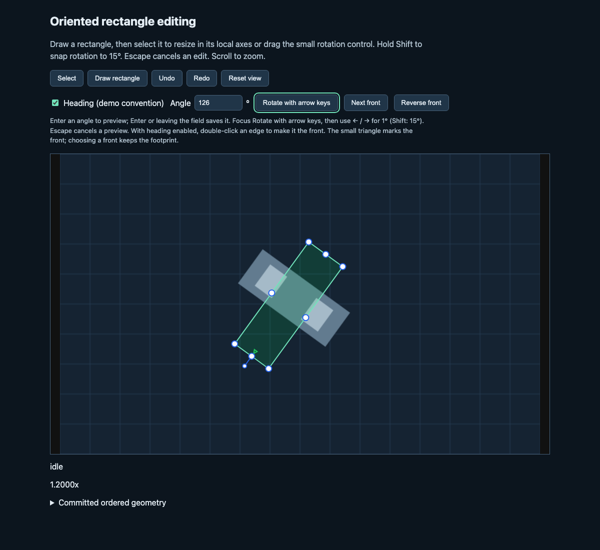

# Oriented rectangle editing example

Run `npm run example:vanilla:dev` from the repository root and open
`http://127.0.0.1:5178/examples/vanilla/oriented-box.html`.

The example uses only the public `supervision` and `supervision/editing`
entrypoints. It creates its own still-image fixture, so no downloads, API keys
or model service are required. A host-owned array and snapshot history receive
one committed detection per edit.

- Draw rectangle creates four ordered corners without an accompanying `rect`.
- Drag the compact external control to rotate. Hold Shift to snap to 15°;
  pressing or releasing Shift updates the preview even while the pointer is still.
- Corner and edge handles resize in the rectangle's local axes.
- Enter an angle in degrees to preview it. Enter or leaving the field saves it;
  Escape restores the committed angle.
- Focus **Rotate with arrow keys**, then use Left/Right for 1° steps or hold
  Shift for 15° steps. Repeated key presses commit once on release. Escape
  cancels the preview. Canvas handles themselves are not keyboard focus targets.
- **Heading (demo convention)** treats local +x as the front, shows a small
  triangle inside that edge, and positions the rotation control outside it.
  Double-click an edge away from its resize handles to choose another front.
  **Next front** and **Reverse front** provide button alternatives. Choosing a
  front reindexes the existing corners, preserving the footprint and resize
  handle positions; it is one undoable edit. Turning heading off restores the
  default top-edge rotation control without changing geometry.
- Escape cancels the current pointer or angle edit. Undo and Redo operate on
  completed edits; each drag or host angle edit creates one history entry.
- Scroll to zoom. Reset view restores the full image.
- Expand Committed ordered geometry to inspect the saved corners. Previews
  update the canvas without entering this committed data or history.

The host implements angle controls with the public
`getOrientedRectangleGeometry()` and `createOrientedBoxGeometry()` helpers.
It configures the engine's `resolveRotation` and `rotationHandle` options;
continuous pointer gestures and their modifier updates stay in the library.
The triangle uses the session's public `previewOverlay` callback. The heading
convention, front choice, keyboard controls and undo history belong to this
example host; the library assigns no class or direction semantics.

General quadrilaterals can render and move but do not receive rectangle
controls. A detection with both an independent `rect` and `orientedBox` retains
its existing axis-aligned rectangle handles. The library assigns no class or
direction semantics to the ordered local axes.



For repeatable mouse, touch, zoom, modifier, front choice, numeric angle,
keyboard and cancellation checks, start this example
on port 5191 and an isolated Chrome instance with remote debugging on port
9336, then run from the repository root:

```sh
node tools/oriented-box-editing-eval.mjs
```

The script accepts the example URL and Chrome debug URL as optional positional
arguments. It writes browser evidence to the ignored `artifacts/` directory.

The browser harness retains the original seven pointer scenarios and adds four
host-policy scenarios. It imports the built editing entrypoint for expected
handle geometry and exercises the example's actual canvas, native double-click
and focused form controls. It does not claim keyboard access to individual
canvas resize handles.
